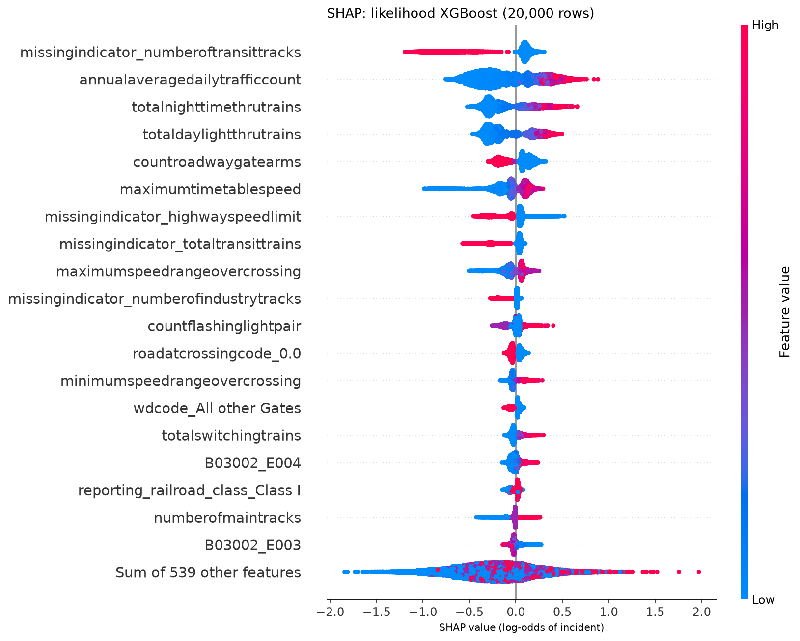
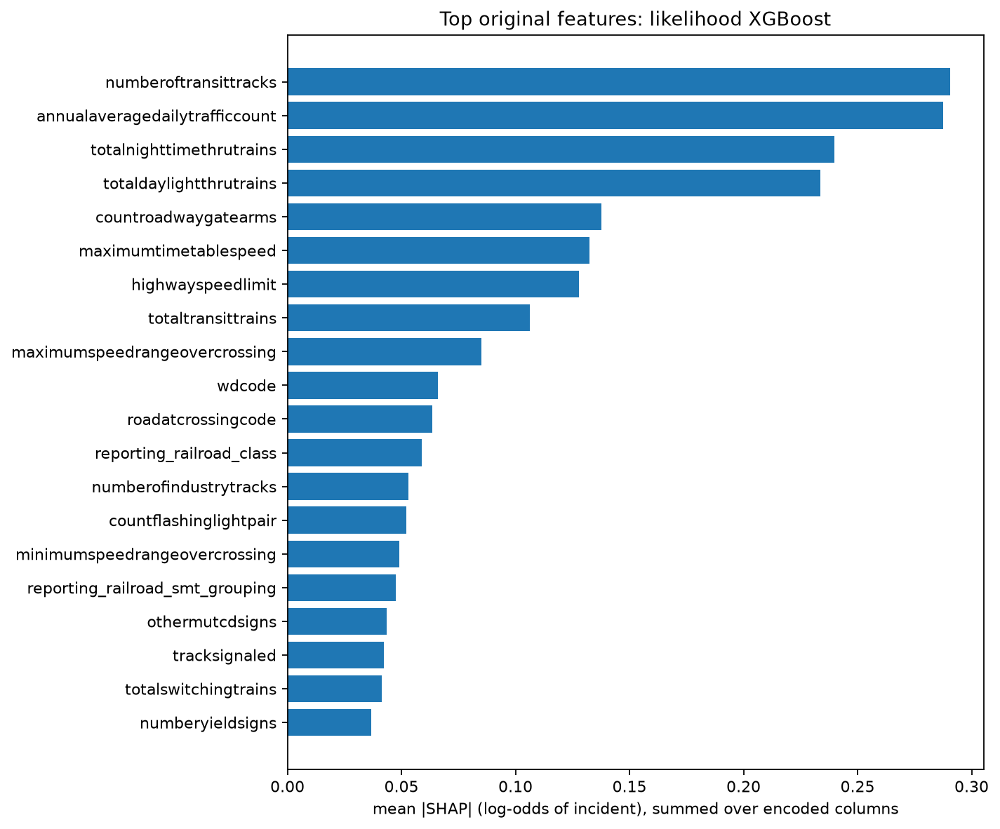
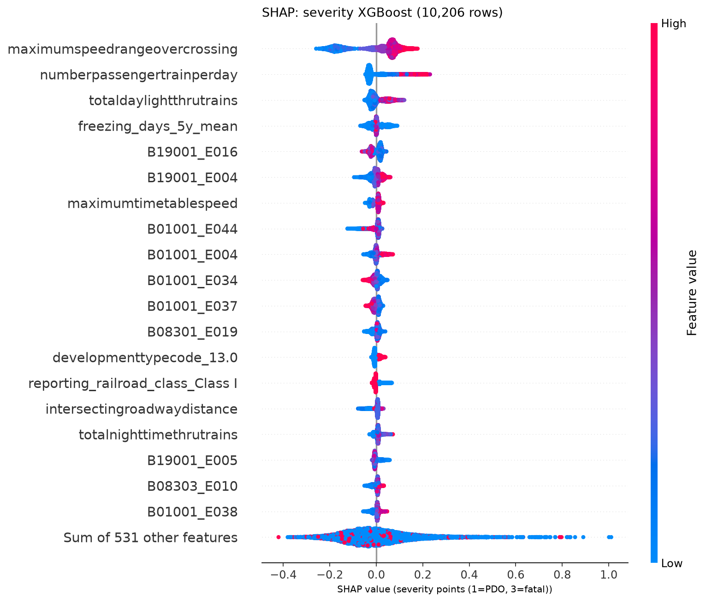
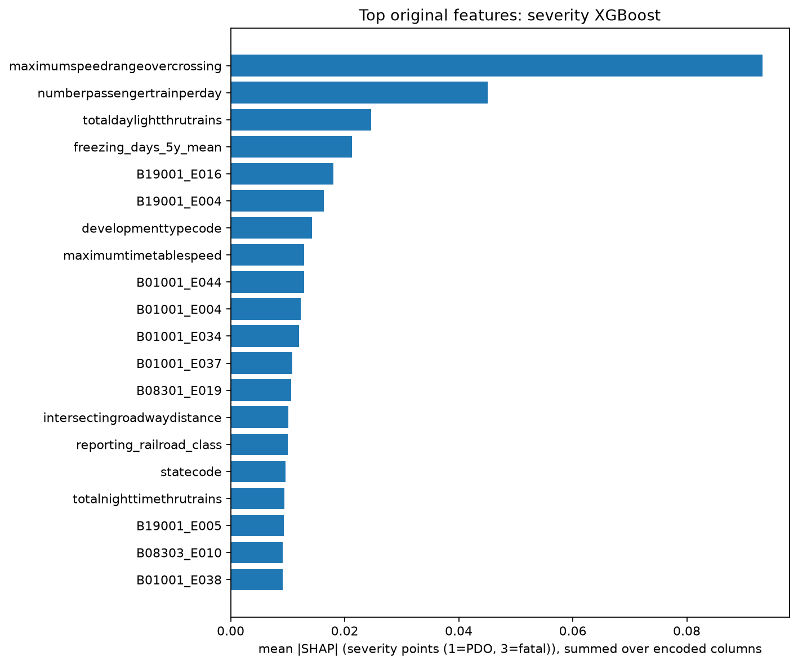

# SHAP results: final XGBoost models

What the SHAP analysis of the team's two final XGBoost models shows, plot by plot, and how to rerun it. No model was retrained; SHAP reads the saved `model.joblib` files.

| Model | Run folder | Explained rows |
|---|---|---|
| Likelihood (incident yes/no) | `results/google drive/likelihood_20261031/xgboost` | 20,000 random rows of the 163,706 from 2024 |
| Severity (regression: 1 = property damage only, 2 = injury, 3 = fatal) | `results/google drive/severity_comparison_20261115_50trials/regression_xgboost` | all 10,206 incident rows (2019–2024) |

All plots are on the **full dataset**, in `results/shap_likelihood_xgboost_full/` and `results/shap_severity_xgboost_full/`. Check that the explained model is the real one: on the full data the likelihood model scores average precision 0.0957 on 2024 and the severity model MAE 0.5980 on its 2024 incident rows, both equal to the values Christian reported.

## Main takeaways

1. **Likelihood is driven by exposure.** More traffic (AADT) and more day and night through trains raise predicted risk. Gate arms and slow timetable speeds lower it.
2. **Blank fields are a major signal in the likelihood model.** The single largest push is "railroad section left blank", which lowers risk a lot. It marks a type of record (very few incidents), not a cause.
3. **Severity is driven by train speed and passenger service.** A higher maximum speed range over the crossing, more passenger trains per day and more daytime through trains raise predicted severity.
4. **The severity model is weak.** On 2024 it has MAE 0.598 against 0.546 for always predicting property damage only. Its SHAP effects are small, so read its plot as what the model leans on, not as strong findings.
5. **Census columns carry 60% of the severity model's total importance** (20% for likelihood), but spread across 146 narrow columns, each with a small effect.

## How to read the plots

SHAP splits one prediction into per-feature pushes from the model's average output. The pushes add up to the prediction.

- **Beeswarm:** one row per feature (most important at the top), one dot per crossing. Horizontal position is the push: right raises the score, left lowers it. Colour is the feature's value, red high and blue low. Red on the right means more of the feature gives a higher score.
- **Units:** log-odds of an incident for likelihood (+0.3 multiplies the odds by about 1.35, +1.0 by about 2.7, −1.0 by about 0.37); severity points for severity.
- **Yes/no rows:** the models use one-hot encoding, so a category appears as its own row (`roadatcrossingcode_0.0`). Red means the crossing is in the category, blue means it isn't.
- **`missingindicator_X` rows:** yes/no flags added by the preprocessing. Red means the value of `X` was blank for that crossing (blanks are filled with the median, and the flag tells the model so).
- **"Sum of N other features":** all features below the top 20, added together per crossing.
- **Bar chart:** mean |SHAP| per original column, with one-hot levels and missing flags summed back. It shows how much a feature matters, not the direction.
- SHAP describes what the model uses, not what causes incidents. Correlated features share credit.

## Likelihood model



What the beeswarm shows, top to bottom:

- **`missingindicator_numberoftransittracks`:** blank (red) pushes risk down by about 0.8 to 1.2, so the odds fall to roughly 0.3 to 0.45 of baseline. Rows with a reported value (blue) sit slightly above zero. This is the largest single push in the model.
- **`annualaveragedailytrafficcount`:** low traffic pushes down to about −0.7, high traffic pushes up to about +0.9. A clear gradient from blue to red.
- **`totalnighttimethrutrains` and `totaldaylightthrutrains`:** few trains push down (about −0.3 to −0.5), many trains push up (to about +0.6 and +0.5).
- **`countroadwaygatearms`:** crossings with gate arms (red, higher count) are pushed down about 0.2 to 0.3; crossings with none (blue) are pushed up. `wdcode_All other Gates` points the same way.
- **`maximumtimetablespeed`, `maximumspeedrangeovercrossing`, `minimumspeedrangeovercrossing`:** low speeds push risk down (down to about −1.0 for timetable speed); high speeds push it up by about 0.1 to 0.3.
- **Other blank flags** (`highwayspeedlimit`, `totaltransittrains`, `numberofindustrytracks`): blank lowers risk (about −0.5, −0.6 and −0.3).
- **Smaller effects:** more main tracks and more flashing light pairs push risk up (to about +0.3 and +0.4); Class I railroads push up slightly.
- **Census columns** (`B03002_E004`, `B03002_E003`) appear low in the top 20. Census columns make up about 20% of the total importance, spread over many columns.
- **"Sum of 539 other features"** spreads from about −1.8 to +2, so the long tail of weak features matters as much as any single one.



Mean |SHAP| by original feature (log-odds): `numberoftransittracks` 0.29 (almost all of it is the blank flag), `annualaveragedailytrafficcount` 0.29, `totalnighttimethrutrains` 0.24, `totaldaylightthrutrains` 0.23, `countroadwaygatearms` 0.14, `maximumtimetablespeed` 0.13, `highwayspeedlimit` 0.13, `totaltransittrains` 0.11, `maximumspeedrangeovercrossing` 0.085, `wdcode` 0.066. Full list: `importance_by_original_feature.csv`; unsummed: `importance_by_encoded_feature.csv`.

## Severity model



- **`maximumspeedrangeovercrossing`:** by far the largest. Low speed ranges push severity down by about 0.2; high ones push it up by up to about 0.18.
- **`numberpassengertrainperday`:** no passenger trains pushes slightly down (about −0.03); many pushes up by as much as about +0.23.
- **`totaldaylightthrutrains` and `maximumtimetablespeed`:** more trains and higher speeds push severity up (to about +0.12 and +0.03).
- **`freezing_days_5y_mean`:** mixed colours on both sides, so the effect is non-linear or depends on other features.
- **Census columns** fill many of the top rows. They are narrow ACS cells with small, mixed effects (details below).
- **`reporting_railroad_class_Class I`** (in the class) pushes slightly down; **`developmenttypecode_13.0`** pushes slightly up.
- **"Sum of 531 other features"** spreads from about −0.4 to +1.0, wider than any single feature, so the model leans on a long tail of weak features.



Mean |SHAP| by original feature (severity points): `maximumspeedrangeovercrossing` 0.093, `numberpassengertrainperday` 0.045, `totaldaylightthrutrains` 0.025, `freezing_days_5y_mean` 0.021, `B19001_E016` 0.018, `B19001_E004` 0.016, `developmenttypecode` 0.014, `maximumtimetablespeed` 0.013, `B01001_E044` 0.013, `B01001_E004` 0.012.

## Census columns in the severity plot

Census columns are 146 of the 224 features and carry about 60% of the total importance, but each one contributes little (the largest census column is 0.018 against 0.093 for train speed). Labels checked against the Census API (2023 ACS 5-year):

| Column | Meaning |
|---|---|
| `B19001_E016` | households earning $150,000 to $199,999 (high counts push severity down) |
| `B19001_E004` | households earning $15,000 to $19,999 (high counts push severity up) |
| `B01001_E044` | females aged 65 and 66 |
| `B01001_E004` | males aged 5 to 9 |
| `B01001_E034` | females aged 22 to 24 |
| `B01001_E037` | females aged 35 to 39 |
| `B08301_E019` | commuters who walked |
| `B03002_E004` / `B03002_E003` | not Hispanic or Latino: Black alone / White alone (likelihood plot) |

These are raw counts for one narrow cell in a census tract, so they scale with how many people live there. They most likely stand in for the kind of area around a crossing and add noise on top, because the severity model has few incident rows relative to its 224 features. Treat them as descriptive, not as findings about any group. If severity feeds an inspection ranking, demographic-count columns can influence which areas are inspected first, which is worth a line in any write-up. Whether performance holds up without them needs retraining (feature ablation); SHAP can't tell you that.

## Missing-value flags (blank fields)

In `numberoftransittracks` (full data), 68.4% of rows report 0 explicitly and a separate 31.4% are blank. A blank is not the same as zero:

- Blank rows have an incident rate of 0.20%, against 1.43% for rows with a value.
- None of them report transit trains (`totaltransittrains` is 0 or blank for all).
- 99.3% of the transit-tracks blanks are also blank for transit trains, and 95.7% are blank for transit tracks, industry tracks and transit trains together.

So whole sections of Part II of the FRA crossing inventory form (Form 6180.71, Box II.4 "Type and Count of Tracks") were left empty on those records. The likely reading is that these are inactive, private or never-completed records, which have far fewer incidents. That is inferred from the pattern and has not been checked against crossing status. The flags are record-type proxies, not causes.

## What this does not tell you

- **Performance without a feature group.** That needs retraining (feature ablation).
- **Causal effects.** A feature that pushes risk up is associated with incidents in the data. Do not read "more gate arms lowers risk" as "adding gates lowers risk".
- **Direction of weak effects.** For the severity model, most effects are within ±0.2 points.

## Rerunning

```sh
D=data/drive/final_dataset.parquet   # the full file; defaults to the 50k sample if omitted
uv run python scripts/shap_xgboost.py --task likelihood --run-dir "<likelihood run folder>/xgboost" --dataset $D --max-rows 20000 --out-dir results/shap_likelihood_xgboost_full
uv run python scripts/shap_xgboost.py --task severity   --run-dir "<severity run folder>/regression_xgboost" --dataset $D --max-rows 20000 --out-dir results/shap_severity_xgboost_full
```

Under a minute each on CPU. Likelihood explains rows from `--year` (default 2024); severity explains incident rows. `--max-rows` caps the rows explained.

Two things to know if you adapt this:

- **Keep the preprocessed matrix sparse.** The team's XGBoost models were trained on sparse output, and XGBoost treats entries absent from a sparse matrix as *missing*, not 0. A dense copy changes how every split routes zeros and gives a different model (on 2024, average precision 0.0397 instead of 0.0957). `scripts/shap_xgboost.py` passes the sparse matrix to XGBoost's own `pred_contribs` and checks that the SHAP values sum to the model's output.
- **Loading the pickles.** The GPU-trained `model.joblib` files fail to unpickle on CPU ("input stream corrupted") even with the same xgboost version, so the script loads only the model section (`load_xgb`). Re-saving the models with `booster.save_model()` would avoid this.
